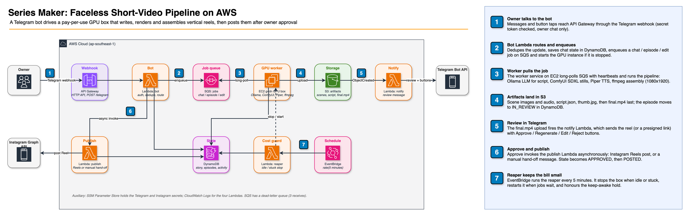

# Series Maker

A Telegram-controlled pipeline that makes **faceless short-video series** (vertical 1080x1920 reels) on a pay-per-use GPU box in AWS. You chat with a bot to develop a story, ask for episodes, review the finished reel in Telegram, and approve it for posting to Instagram Reels.

The GPU instance is the only expensive part, so the system treats it as disposable: it wakes when you message the bot and is stopped automatically when idle.



> Full diagram: [docs/architecture.drawio](docs/architecture.drawio). Open it with the draw.io desktop app, the VS Code draw.io extension, or <https://app.diagrams.net>.

## How it works

1. **You message the bot.** Telegram calls an API Gateway webhook (`POST /telegram`). The `bot` Lambda checks the secret token, accepts only the owner's chat, de-duplicates the update and routes it.
2. **Story development.** Free text becomes a `chat` job. The LLM brainstorms with you and, once you confirm, emits a *story bible* (title, characters, style: `animation` or `realistic`) that is stored in DynamoDB.
3. **Episodes.** `/episode` (or a tap on a button) enqueues an `episode` job. The bot claims the episode (`DRAFT -> GENERATING`) first, so a double tap cannot queue a duplicate, and starts the GPU instance if it is stopped.
4. **Generation on the GPU box.** The worker service long-polls SQS and, per episode:
   - writes a 6-10 scene script with **Ollama** (default model `llama3.3:70b`, GPUs 0-2),
   - renders one still per scene with **ComfyUI** (SDXL: Animagine XL 3.1 or Juggernaut XL v9, GPU 3),
   - narrates each scene with **Piper** TTS (`en_US-lessac-medium`),
   - assembles a 1080x1920 H.264/AAC reel with **ffmpeg** (pan/zoom per scene, burned-in captions).
5. **Review.** Artifacts go to S3, `final.mp4` last. That upload triggers the `notify` Lambda, which sends the reel (or a presigned link above Telegram's 20 MB URL limit) with **Approve / Regenerate / Edit / Reject** buttons.
6. **Publish.** Approve invokes the `publish` Lambda asynchronously. It posts to Instagram Reels, or in manual mode sends you the video or a link to upload yourself.
7. **Cost guard.** An EventBridge rule runs the `reaper` Lambda every 5 minutes to stop the box when it is idle or stuck.

### Episode states

```
DRAFT -> GENERATING -> IN_REVIEW -> APPROVED -> POSTED
             ^   |         |  \
             |   v         |   `-> REJECTED
           (retry)         `-> GENERATING   (Regenerate / Edit)
```

Transitions are enforced in [models.py](src/seriesmaker/models.py); an illegal one raises `InvalidTransition`.

### Bot interface

| Input | What it does |
| --- | --- |
| Any text | Continue the story chat (or, after tapping **Edit**, apply the change to that episode) |
| `/episode` | Start the next episode, or retry a draft or stale one |
| `/retry` | Retry a failed publish |
| **Approve** | Publish the episode |
| **Regenerate** | Re-render with new seeds (the generation counter shifts every scene seed by 1000) |
| **Edit** | Your next message becomes an edit instruction; unchanged scenes are reused from S3 |
| **Reject** | Mark the episode rejected |

## The reaper (what keeps the bill down)

Decision order for a running instance, every 5 minutes ([reaper/handler.py](src/seriesmaker/reaper/handler.py)):

1. A **keep-awake hold** is active -> keep.
2. The worker never reported activity -> keep during the bootstrap grace (default 90 min after launch), then stop and tell you.
3. Jobs are queued: keep while activity is fresher than `stuck_after_minutes` (20); past that the queue is "not draining", so stop and tell you once.
4. Otherwise stop after `idle_minutes` (15) without activity.

A *stopped* instance with queued jobs is restarted, at most once per 30 minutes.

Use [scripts/keep_awake.sh](scripts/keep_awake.sh) `<hours>` to pin the box on for model downloads, a long first boot, or an SSH session (`0` ends the hold).

> **Billing note:** the default `g4dn.12xlarge` costs about $3.91/hour on-demand while running. Stopped instances still pay for the 300 GB gp3 root volume. The reaper is a safety net, not a guarantee, so check the console after experiments.

## Repository layout

```
src/seriesmaker/
  bot/        Telegram webhook Lambda (auth, dedupe, routing, wake the box)
  notify/     S3-triggered Lambda: send the finished reel for review
  publish/    Instagram Reels posting, manual hand-off, token refresh
  reaper/     Scheduled idle/stuck stop and restart logic
  worker/     Runs on the GPU box
    main.py       SQS loop, heartbeat, retries, failure handling
    pipeline.py   chat and episode jobs
    llm.py        Ollama client, script/bible validation
    comfy.py      ComfyUI client
    profiles.py   Style profiles and workflows/*.json
    tts.py        Piper wrapper
    assemble.py   ffmpeg reel assembly
  store.py    Single-table DynamoDB access     jobs.py   SQS wrapper
  power.py    EC2 start/stop                   telegram.py   Bot API client
terraform/      Main stack (VPC, EC2, DynamoDB, SQS, S3, Lambdas, API Gateway, IAM)
  build.sh        Builds build/lambda.zip
  user_data.sh    First-boot bootstrap for the GPU box
scripts/        deploy_worker.sh, set_webhook.sh, keep_awake.sh
private-comfyui/  Separate, standalone ComfyUI stack (see below)
manage.sh       Interactive menu for the main stack (deploy, SSH, logs, GPU status)
```

## AWS resources

| Resource | Purpose |
| --- | --- |
| API Gateway (HTTP API) | Telegram webhook, `POST /telegram` |
| Lambda `bot`, `notify`, `publish`, `reaper` | Python 3.12, one shared zip, one least-privilege IAM role each |
| EC2 `g4dn.12xlarge` (Ubuntu 22.04) | GPU worker; ComfyUI, Ollama and the worker bind to `127.0.0.1` only |
| SQS `jobs` + DLQ | Work queue (visibility 1800 s, DLQ after 3 receives) |
| DynamoDB (on-demand) | Story bible, episodes, chat history, worker activity, keep-awake hold, update de-dupe |
| S3 | `episodes/<series>/<n>/` scenes, `script.json`, `thumb.jpg`, `final.mp4`; private, TLS-only, SSE, 30-day expiry |
| EventBridge | `rate(5 minutes)` trigger for the reaper |
| SSM Parameter Store | Secrets (see below) |
| CloudWatch Logs | 14-day retention for the four Lambdas |

The instance carries `sm-table`, `sm-queue-url`, `sm-bucket` and `sm-llm-model` tags. `user_data.sh` reads them from IMDS, so no resource names are templated into the script and a changed `user_data` never silently replaces the box (`lifecycle.ignore_changes`). Rebuild deliberately with `terraform apply -replace=aws_instance.comfyui`.

## Prerequisites

- AWS account and CLI credentials, Terraform >= 1.0, Python 3.12, `curl`
- GPU quota for the instance type in your region (default `ap-southeast-1`)
- A Telegram bot token (from @BotFather) and your numeric chat ID
- Optional, for auto-posting: an Instagram professional account and Graph API token

## Setup

### 1. Configure

```bash
cd terraform
cp terraform.tfvars.example terraform.tfvars
# set allowed_ip to your address: curl ifconfig.me  ->  "x.x.x.x/32"
```

Other variables worth knowing (see `variables.tf` and `app.tf`):

| Variable | Default | Meaning |
| --- | --- | --- |
| `instance_type` | `g4dn.12xlarge` | GPU box size |
| `volume_size` | `300` | Root volume GB (LLM plus checkpoints) |
| `llm_model` | `llama3.3:70b` | Ollama tag pulled at first boot |
| `idle_minutes` | `15` | Idle time before the reaper stops the box |
| `bootstrap_grace_minutes` | `90` | Reaper patience during first boot |
| `stuck_after_minutes` | `20` | Queued jobs keep the box up only while activity is this fresh |
| `job_retention_seconds` | `7200` | Bounds how long an undrained job can keep restarting the box |
| `episode_retention_days` | `30` | S3 expiry for `episodes/` |
| `instagram_graph_base` | `https://graph.instagram.com` | Use `https://graph.facebook.com` for Facebook-Login tokens |

### 2. Create the secrets

These must exist in SSM before the Lambdas can run (names are fixed by the code):

```bash
aws ssm put-parameter --name /seriesmaker/telegram_token  --type SecureString --value '<bot token>'
aws ssm put-parameter --name /seriesmaker/webhook_secret  --type SecureString --value "$(openssl rand -hex 24)"
aws ssm put-parameter --name /seriesmaker/owner_chat_id   --type SecureString --value '<your chat id>'
# optional, for Instagram publishing
aws ssm put-parameter --name /seriesmaker/instagram_enabled --type String       --value true
aws ssm put-parameter --name /seriesmaker/instagram_user_id --type String       --value '<ig user id>'
aws ssm put-parameter --name /seriesmaker/instagram_token   --type SecureString --value '<long-lived token>'
```

If Instagram is not enabled, approving an episode uses the manual hand-off (the video or a link is sent to you in Telegram). The publish Lambda refreshes the Instagram token in place when it is older than 30 days.

### 3. Build and deploy

```bash
terraform/build.sh                                  # builds terraform/build/lambda.zip
cd terraform && terraform init && terraform apply   # or ./manage.sh and pick "Deploy"
cd .. && scripts/set_webhook.sh                     # registers the Telegram webhook
scripts/deploy_worker.sh                            # uploads the worker package to S3
```

The first boot installs NVIDIA drivers, ComfyUI, Ollama, Piper and the worker, pulls the LLM, then reboots. Expect a long first boot; the reaper waits `bootstrap_grace_minutes` before giving up. Use `scripts/keep_awake.sh 3` if you want to be sure it is not stopped mid-install.

### 4. Download the image models

The SDXL checkpoints are not baked in. On the box (via SSH):

```bash
/opt/comfyui/download-models.sh && sudo systemctl restart comfyui
```

Filenames must match [profiles.py](src/seriesmaker/worker/profiles.py).

### 5. Try it

Message your bot with a topic, confirm the story, then send `/episode`. If the box was stopped, expect a few minutes of "Waking up" before the first reply.

## Day-to-day operations

| Task | Command |
| --- | --- |
| Ship new Lambda code | `terraform/build.sh && (cd terraform && terraform apply)` |
| Ship new worker code | `scripts/deploy_worker.sh --restart` (the unit also self-updates from S3 on start) |
| Hold the box awake | `scripts/keep_awake.sh <hours>` |
| SSH, logs, GPU status | `./manage.sh` (menu) |
| Open ComfyUI locally | `ssh -N -L 8188:127.0.0.1:8188 -i terraform/comfyui-key.pem ubuntu@<ip>` (see `terraform output comfyui_tunnel_command`) |
| Worker logs on the box | `journalctl -u seriesmaker-worker -f` |
| Tear everything down | `terraform destroy` in `terraform/` |

### Troubleshooting

- **"Worker never started"** from the bot: first boot failed or ran past the grace window. SSH in and read `/var/log/user-data.log`, then fix and `sudo systemctl restart seriesmaker-worker`.
- **"Queue not draining"**: jobs were queued but the worker made no progress for `stuck_after_minutes`. Check `journalctl -u seriesmaker-worker` and `nvidia-smi`; failed jobs are retried up to 3 times, then dropped.
- **Episode stuck in GENERATING**: send `/episode`; stale ones (no update for an hour) are retried.
- **Instagram post failed**: send `/retry`. After an ambiguous failure the bot tells you when to retry so a half-posted reel is not double-posted.

## Security model

- Webhook requests must carry Telegram's secret token; every update from a chat other than the owner's is ignored.
- No inbound ports except SSH from `allowed_ip`; the services on the box listen on `127.0.0.1`. IMDSv2 is required.
- Secrets live only in SSM; Lambda roles read just the parameters they need ([iam.tf](terraform/iam.tf)).
- The bucket blocks public access, denies non-TLS requests and encrypts at rest. Reels are shared only by short-lived presigned URLs.
- The Terraform state and the generated SSH key (`terraform/comfyui-key.pem`) are local. Both are git-ignored; keep them private or move state to a remote backend.

## Testing

```bash
python3.12 -m venv .venv && source .venv/bin/activate
pip install -e '.[dev]'
pytest
```

The suite uses `moto` for DynamoDB, SQS, S3, EC2 and SSM and `responses` for HTTP, so it needs no AWS credentials. It includes an IAM coverage test that checks the Lambda roles cover the AWS calls the code makes.

## `private-comfyui/` (separate stack)

A standalone, in-progress Terraform stack for a plain **private ComfyUI** workstation, independent of the Series Maker pipeline: one `g4dn.xlarge` on the AWS Deep Learning AMI, a dedicated persistent 200 GB data volume (daily snapshots, keep 7), self-stop after idle, and access over SSM Session Manager. Drive it with `private-comfyui/manage.sh` (`plan | apply | status | start | stop | tunnel | logs | download-models | remove-instance`). `remove-instance` never targets the data volume.

## Tech stack

Python 3.12 (boto3, requests, Pillow), Terraform (AWS provider ~> 5.0), Ollama, ComfyUI, Piper TTS, ffmpeg, AWS Lambda, API Gateway, SQS, DynamoDB, S3, EventBridge, EC2.
